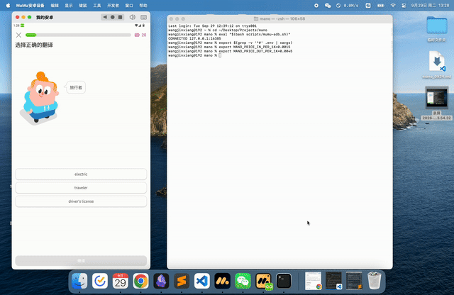

# mano

A thin **VLM-driven Android GUI automation engine** with a small, whitelisted
ADB surface and a growing library of per-app **packs**.

mano looks at the screen with a hosted GUI vision-language model (VLM), proposes
**one safe action at a time**, and executes it through a deliberately tiny ADB
action surface (tap / swipe / text / a few keyevents). App-specific knowledge —
prompts, guards, deterministic solvers — lives in `packs/`, never in the engine.

> **Status (v0.1.2).** The core engine — thin runner, Pack `resolve`/`verify`,
> durable action journal + crash recovery, pluggable text backends, bounded
> re-plan feedback — is implemented and has completed Consumer production
> acceptance on a **recorded** MuMu + OpenATX AdbKeyboard combination (see
> [docs/device-acceptance.md](docs/device-acceptance.md)). This does **not** mean
> every Android device/emulator is certified, nor that the 0.x API is frozen:
> interfaces may still change, and new device combinations must re-run their own
> acceptance. Treat `mano` as a 0.x dependency pinned to an immovable tag.

## Demo



▶️ **[Watch the full screen recording (MP4)](https://github.com/user-attachments/assets/9922bee1-aead-42dd-bee1-ec60f5ba30c1)**

## Why "engine + packs" instead of a zero-shot agent

A GUI VLM can already look at almost any unseen screen and propose a plausible
tap (**perception generalizes**). Reliably *completing* a multi-step task in an
unseen app does **not** generalize yet — it needs a thin per-app layer. mano
makes that boundary explicit across three roles:

- **Core (`mano/`)** — app-agnostic mechanism: bounded observation, re-validation,
  the generic safety gates, single execution, the durable journal, and crash
  recovery. It never interprets a control or carries app strings.
- **Pack (`packs/<app>/`)** — app judgment: page semantics, `resolve` (raw model
  action → stable `semantic_target` + physical action), `verify` (re-confirm the
  same target on the latest page), and business-control facts.
- **Consumer** — the caller/owner of a run: the device, the text backend, the
  `approve` policy, a stable `run_id`, leases/fencing, retry budget, and
  human-review routing. **The Core is not a business-authorization system.**

The **thin runner** (`mano.runner.run`) + `Pack.resolve`/`verify` is the current,
standard lifecycle. [`packs/duolingo/run_via_runner.py`](packs/duolingo/run_via_runner.py)
is the recommended wiring **reference** (not a full production template);
[`packs/duolingo/run.py`](packs/duolingo/run.py) is an older in-file driver loop
kept only as an **A/B baseline** (it still carries deterministic solvers not yet
migrated to the thin runner) and is **not** the entry point for new integrations.

## Install

mano has **no third-party runtime dependencies** (standard library only), so a
plain virtual environment is enough. Install from an **immovable release tag**
(do not depend on a sibling editable checkout):

```bash
python3 -m venv .venv
. .venv/bin/activate
python -m pip install 'mano @ git+https://github.com/jimmywang2020/mano.git@v0.1.2'
```

`uv` is optional — if you use it, `uv pip install 'mano @ git+...@v0.1.2'` works
too — but nothing here assumes `uv` is on the machine.

Verify the exact artifact you installed (version, tag, commit, non-editable):

```bash
python -c "import importlib.metadata as m; print(m.version('mano'))"   # 0.1.2
python - <<'PY'
import importlib.metadata as m
d = m.Distribution.from_name("mano")
print(d.read_text("direct_url.json"))   # requested_revision == v0.1.2, commit_id pinned
PY
```

A correct install shows `requested_revision` `v0.1.2`, a pinned `commit_id`, and
`"editable": false` (or no `dir_info.editable`).

## Requirements

- Python **3.10+** (runtime uses the standard library only — no third-party deps)
- `adb` (Android platform-tools) on `PATH`, or set `MANO_ADB_PATH`
- An Android emulator/device with the target app installed and logged in
  (developed against **MuMu Player**, serial `127.0.0.1:16384`)
- An API key for a GUI VLM (default: DashScope / 阿里百炼 `gui-plus`), via
  `MANO_API_KEY` (or `DASHSCOPE_API_KEY`)

## Quickstart (risk-ordered)

Load a trusted local `.env` with proper shell assignment semantics (handles
spaces/special characters; `.env` must be valid `KEY=value` lines):

```bash
cp .env.example .env            # then fill MANO_API_KEY
set -a
. ./.env
set +a
```

Then proceed from zero-risk to device-modifying, in order:

1. **Install & verify** — see [Install](#install) (`importlib.metadata.version`).
2. **Parse one screenshot (no device)** — sanity-check the VLM on a single image:
   ```bash
   python3 packs/duolingo/run.py smoke --image /path/to/screenshot.png
   ```
3. **ADB / backend preflight (read-only)** — confirm the device and, if you need
   Unicode text, that the text backend is available *before* any run. See
   [docs/integration-guide.md](docs/integration-guide.md).
4. **Read-only Observation** — ground-truth the current screen without acting
   (`capture_observation()`, or the baseline XML dump):
   ```bash
   python3 packs/duolingo/run.py dump --device 127.0.0.1:16384
   ```
5. **Human-approved small step** — drive the thin runner with an `approve`
   callback that vetoes each device action (see the integration guide).
6. **Production wiring** — for an unattended run that may change device state,
   enable a durable `journal`, a stable `run_id`, and `recovery_decide`.

> New integrations should **not** start by running the baseline `run.py run`
> loop; use the thin runner via [docs/integration-guide.md](docs/integration-guide.md).

## Safety

mano is built around a reliability cage, not blind autonomy:

- **Whitelisted ADB surface** — only tap/swipe/short text/a few keyevents;
  unknown or high-risk actions are refused.
- **Gates run before every device action** — foreground/boundary checks, the
  Pack `guard`, the Consumer `approve` veto, re-validation, and `verify` all run
  before a single execution.
- **No purchases** — the model is instructed never to buy/subscribe/start a
  trial, and paywall markers hand control back.
- **Approval or authorized autonomy** — mano supports both per-action human
  approval and Consumer-authorized autonomous runs. An autonomous run must supply
  the Consumer's own business safety gates; a production, device-modifying,
  unattended run must enable the durable journal, a stable `run_id`, and recovery
  decisions. The Core itself is not a business-authorization system.

Evidence (screenshots + XML + model output) is written under each run's
`run_dir` (with a journal, per-attempt under `run_dir/attempts/<id>/`). These can
contain account screenshots and are git-ignored — do not publish them, and apply
your own retention/cleanup policy.

Use mano only on your own accounts and in compliance with each app's terms of
service. It is a research/automation tool, not a bot farm.

## Layout

```
mano/                 # generic engine (stdlib only)
  errors.py           # ManoError, ManoNetworkError
  media.py            # PNG size + image data-url encoding
  action_codec.py     # parse <tool_call>, map 1000x1000 coords -> pixels, validate
  adb_executor.py     # whitelisted Adb + execute_action + validate_executable_action
  text_input.py       # pluggable text backends (ASCII / OpenATX Unicode)
  observation.py      # bounded (non-atomic) screenshot+XML+foreground capture
  gui_plus_client.py  # OpenAI-compatible GUI-VLM client (GuiVLM)
  ui_xml.py           # uiautomator XML parsing helpers
  pack.py             # Pack protocol: resolve / verify / reconcile / hook
  runner.py           # the thin run loop + RunResult
  action_journal.py   # durable per-action journal + crash recovery (optional)
packs/
  duolingo/           # first app pack
    pack.py           # DuolingoPack (migration passthrough adapter)
    prompts.py        # system prompt + per-step instruction
    guards.py         # paywall / lesson-done markers / foreground pkg
    matching_solver.py# deterministic "选择配对" solver (baseline only)
    run.py            # legacy in-file driver loop (A/B baseline)
    run_via_runner.py # thin-runner wiring reference
```

## Documentation

| Doc | Audience / purpose |
|---|---|
| [docs/integration-guide.md](docs/integration-guide.md) | **Third-party integrators** — install, construct `Adb`/backend/Pack/client, call `runner.run()`, journal, `run_id`, recovery, `RunResult`. |
| [docs/adding-a-pack.md](docs/adding-a-pack.md) | **Pack authors** — the `resolve`/`verify` contract, stable semantic identity, text input, guards. |
| [docs/result-and-error-reference.md](docs/result-and-error-reference.md) | Result codes & error namespaces: meaning, side-effect risk, retryability, review, handling. |
| [docs/troubleshooting.md](docs/troubleshooting.md) | Symptom-first diagnosis (ADB, IME/backend, VLM parse, REOBSERVE, BLOCK, journal, recovery). |
| [docs/device-acceptance.md](docs/device-acceptance.md) | Real-device acceptance record (scope = recorded device combinations). |
| [docs/action-journal-design.md](docs/action-journal-design.md) | Deep journal/recovery protocol & failure-window design reference. |
| [CHANGELOG.md](CHANGELOG.md) | Per-tag behavior changes, metadata-only releases, migration notes. |
| [CONTRIBUTING.md](CONTRIBUTING.md) | Dev environment, tests, Core/Pack/Consumer boundary, release flow. |
| [docs/harness-rules.md](docs/harness-rules.md) | **Maintainer-internal** harness rules (not an integration guide). |
| [docs/review-response-1020.md](docs/review-response-1020.md) | **Historical** review responses (not a current usage guide). |

## License

[MIT](LICENSE).
